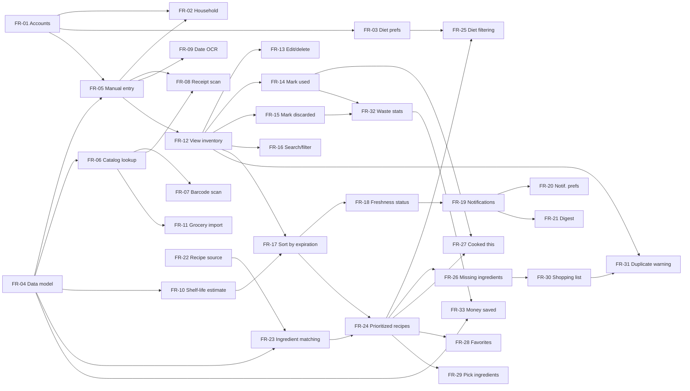

# FreshKeep — Initial Requirements Backlog

**Elicitation pass:** 1 (initial)
**Status of all items:** Proposed
**Source problem statement:** see [README.md](README.md)

## Metadata Legend

| Field | Values |
|---|---|
| **ID** | `FR-xx` = functional requirement, `NFR-xx` = non-functional requirement |
| **Epic** | ACC Accounts & Household · INV Inventory Capture · MGT Inventory Management · EXP Expiration Tracking · REC Recipe Suggestions · SHP Shopping · INS Waste Insights |
| **Priority (MoSCoW)** | **Must** = required for MVP · **Should** = important, not critical · **Could** = nice to have · **Won't** = out of scope for this release |
| **Size** | S (≈1–3 days) · M (≈1 week) · L (≈2–3 weeks) · XL (≈1+ month) — rough estimates for planning only |
| **Stakeholder** | Household User, Household Member, Product Owner, Ops/Security |
| **Source** | *Stated* = directly from the problem statement · *Inferred* = derived during elicitation to make a stated need workable |
| **Depends On** | Requirements that must be in place first |

---

## Epic ACC — Accounts & Household

### FR-01 — Account registration and sign-in
- **Story:** As a household user, I want to create an account and sign in so that my food inventory is saved and available across devices.
- **Acceptance criteria:**
  - User can register with email/password or a third-party sign-in (Google/Apple).
  - User can sign out and reset a forgotten password.
  - Inventory data is tied to the signed-in account.
- **Type:** Functional · **Epic:** ACC · **Priority:** Must · **Size:** M · **Stakeholder:** Household User · **Source:** Inferred
- **Depends On:** —
- **Tags:** `auth`, `mvp`

### FR-02 — Shared household inventory
- **Story:** As a household member, I want to share one inventory with the people I live with so that everyone's purchases and usage are reflected in the same list.
- **Acceptance criteria:**
  - Account owner can invite members by email or link.
  - All members see and edit the same inventory; changes appear for others within 1 minute.
  - Owner can remove members.
- **Type:** Functional · **Epic:** ACC · **Priority:** Should · **Size:** L · **Stakeholder:** Household Member · **Source:** Inferred
- **Depends On:** FR-01, FR-05
- **Tags:** `collaboration`, `sync`

### FR-03 — Dietary preferences and allergies
- **Story:** As a household user, I want to record dietary restrictions and allergies so that recipe suggestions are safe and relevant.
- **Acceptance criteria:**
  - User can select common diets (vegetarian, vegan, gluten-free, etc.) and allergens.
  - Preferences are saved to the profile and editable at any time.
- **Type:** Functional · **Epic:** ACC · **Priority:** Should · **Size:** S · **Stakeholder:** Household User · **Source:** Inferred
- **Depends On:** FR-01
- **Tags:** `profile`, `recipes`, `safety`

---

## Epic INV — Inventory Capture

### FR-04 — Food item data model
- **Story:** As the product owner, I need each stored food item to carry the attributes required for tracking and recipe matching.
- **Acceptance criteria:**
  - Each item stores: name, category, quantity, unit, purchase date, expiration date, date source (printed vs. estimated), storage location (fridge/freezer/pantry), and optional price.
  - Items belong to exactly one household inventory.
- **Type:** Functional · **Epic:** INV · **Priority:** Must · **Size:** M · **Stakeholder:** Product Owner · **Source:** Stated ("stores food items and ingredients… and their expiration dates")
- **Depends On:** —
- **Tags:** `data-model`, `mvp`

### FR-05 — Manual item entry
- **Story:** As a household user, I want to add a food item by typing its details so that I can track anything, even items without a barcode.
- **Acceptance criteria:**
  - User can enter name, quantity, unit, storage location and expiration date.
  - Expiration date may be left blank, in which case FR-10 supplies an estimate.
  - Item appears in the inventory immediately after saving.
- **Type:** Functional · **Epic:** INV · **Priority:** Must · **Size:** S · **Stakeholder:** Household User · **Source:** Stated ("monitors and stores food items… as they are purchased")
- **Depends On:** FR-01, FR-04
- **Tags:** `capture`, `mvp`

### FR-06 — Product catalog lookup
- **Story:** As a household user, I want the app to recognize common products so that names and categories are filled in for me.
- **Acceptance criteria:**
  - App queries an external food product database (e.g., Open Food Facts) by barcode or name.
  - Returned name and category pre-fill the entry form; user can override them.
  - If no match is found, user falls back to manual entry.
- **Type:** Functional · **Epic:** INV · **Priority:** Should · **Size:** M · **Stakeholder:** Household User · **Source:** Inferred
- **Depends On:** FR-04
- **Tags:** `capture`, `integration`, `third-party`

### FR-07 — Barcode scanning
- **Story:** As a household user, I want to scan an item's barcode with my phone camera so that adding groceries is fast.
- **Acceptance criteria:**
  - Camera scanner recognizes UPC/EAN barcodes.
  - A successful scan opens a pre-filled entry form via FR-06.
  - User can scan multiple items in a row without leaving the scanner.
- **Type:** Functional · **Epic:** INV · **Priority:** Should · **Size:** M · **Stakeholder:** Household User · **Source:** Inferred
- **Depends On:** FR-06
- **Tags:** `capture`, `camera`, `mobile`

### FR-08 — Receipt scanning for bulk entry
- **Story:** As a household user, I want to photograph my grocery receipt so that a whole shopping trip is added at once.
- **Acceptance criteria:**
  - OCR extracts line items from a receipt photo.
  - User reviews, corrects and confirms items before they are added.
  - Unrecognized lines are flagged rather than silently dropped.
- **Type:** Functional · **Epic:** INV · **Priority:** Could · **Size:** XL · **Stakeholder:** Household User · **Source:** Inferred
- **Depends On:** FR-05, FR-06
- **Tags:** `capture`, `ocr`, `ml`

### FR-09 — Expiration date capture by camera
- **Story:** As a household user, I want to photograph the printed date on a package so that I don't have to type it.
- **Acceptance criteria:**
  - OCR reads common date formats (e.g., "BEST BY 10/24/26", "EXP 24 OCT").
  - Detected date is shown for confirmation before saving.
- **Type:** Functional · **Epic:** INV · **Priority:** Could · **Size:** L · **Stakeholder:** Household User · **Source:** Inferred
- **Depends On:** FR-05
- **Tags:** `capture`, `ocr`, `camera`

### FR-10 — Estimated shelf life
- **Story:** As a household user, I want the app to estimate an expiration date for items with no printed date (e.g., produce, leftovers) so that every item can be tracked.
- **Acceptance criteria:**
  - Estimate uses item category and storage location (e.g., fridge vs. freezer).
  - Estimated dates are visibly labeled "estimated" (see NFR-10).
  - User can override the estimate.
- **Type:** Functional · **Epic:** INV · **Priority:** Must · **Size:** M · **Stakeholder:** Household User · **Source:** Inferred (needed for an "exhaustive list" with expiration dates)
- **Depends On:** FR-04
- **Tags:** `expiration`, `food-safety`, `mvp`

### FR-11 — Online grocery order import
- **Story:** As a household user, I want items from my online grocery orders added automatically so that I don't enter them by hand.
- **Acceptance criteria:**
  - Connects to at least one grocery delivery provider and imports purchased items.
- **Type:** Functional · **Epic:** INV · **Priority:** Won't (this release) · **Size:** XL · **Stakeholder:** Household User · **Source:** Inferred
- **Depends On:** FR-06
- **Tags:** `capture`, `integration`, `future`
- **Note:** Deferred; depends on partner API availability.

---

## Epic MGT — Inventory Management

### FR-12 — View inventory
- **Story:** As a household user, I want to see a complete list of the food I have so that I know what's in my kitchen without opening every cupboard.
- **Acceptance criteria:**
  - List shows name, quantity, storage location and expiration date for every item.
  - List can be grouped by storage location.
- **Type:** Functional · **Epic:** MGT · **Priority:** Must · **Size:** S · **Stakeholder:** Household User · **Source:** Stated ("an exhaustive list of the food items we have")
- **Depends On:** FR-05
- **Tags:** `inventory`, `mvp`

### FR-13 — Edit and delete items
- **Story:** As a household user, I want to correct or remove an item so that the inventory stays accurate.
- **Acceptance criteria:**
  - Any field of an item can be edited.
  - Deleting asks for confirmation.
- **Type:** Functional · **Epic:** MGT · **Priority:** Must · **Size:** S · **Stakeholder:** Household User · **Source:** Inferred
- **Depends On:** FR-12
- **Tags:** `inventory`, `mvp`

### FR-14 — Mark item used (fully or partially)
- **Story:** As a household user, I want to mark that I used all or part of an item so that the inventory reflects what's actually left.
- **Acceptance criteria:**
  - User can mark an item fully used (removed from active inventory) or reduce its quantity.
  - Used items are recorded in history for FR-32.
- **Type:** Functional · **Epic:** MGT · **Priority:** Must · **Size:** S · **Stakeholder:** Household User · **Source:** Inferred
- **Depends On:** FR-12
- **Tags:** `inventory`, `mvp`

### FR-15 — Mark item discarded
- **Story:** As a household user, I want to record when I throw something away and why so that I can see where waste happens.
- **Acceptance criteria:**
  - User can mark an item discarded with a reason (expired, spoiled early, didn't like it, other).
  - Discarded items are recorded in history for FR-32.
- **Type:** Functional · **Epic:** MGT · **Priority:** Should · **Size:** S · **Stakeholder:** Household User · **Source:** Inferred
- **Depends On:** FR-12
- **Tags:** `inventory`, `waste-tracking`

### FR-16 — Search and filter inventory
- **Story:** As a household user, I want to search and filter my inventory so that I can quickly check whether I have something.
- **Acceptance criteria:**
  - Text search by item name.
  - Filters by category, storage location and freshness status.
- **Type:** Functional · **Epic:** MGT · **Priority:** Should · **Size:** S · **Stakeholder:** Household User · **Source:** Inferred
- **Depends On:** FR-12
- **Tags:** `inventory`, `search`

---

## Epic EXP — Expiration Tracking

### FR-17 — Sort by soonest expiration
- **Story:** As a household user, I want my inventory ordered by soonest expiration date first so that I can see what to use up next.
- **Acceptance criteria:**
  - Default sort is ascending by expiration date (printed or estimated).
  - Already-expired items appear at the top.
- **Type:** Functional · **Epic:** EXP · **Priority:** Must · **Size:** S · **Stakeholder:** Household User · **Source:** Stated ("order these items, soonest expiration dates first")
- **Depends On:** FR-10, FR-12
- **Tags:** `expiration`, `mvp`

### FR-18 — Freshness status indicators
- **Story:** As a household user, I want each item labeled as fresh, expiring soon or expired so that I can scan the list at a glance.
- **Acceptance criteria:**
  - Each item shows a status badge with both color and text (not color alone; see NFR-06).
  - "Expiring soon" threshold defaults to 3 days and is configurable.
- **Type:** Functional · **Epic:** EXP · **Priority:** Must · **Size:** S · **Stakeholder:** Household User · **Source:** Stated ("spread awareness of food expiration dates")
- **Depends On:** FR-17
- **Tags:** `expiration`, `ui`, `mvp`

### FR-19 — Expiration notifications
- **Story:** As a household user, I want a notification before an item expires so that I'm reminded to use it in time.
- **Acceptance criteria:**
  - Push notification is sent when an item enters "expiring soon."
  - Tapping the notification opens recipe suggestions using that item (FR-24).
  - User can turn notifications off.
- **Type:** Functional · **Epic:** EXP · **Priority:** Must · **Size:** M · **Stakeholder:** Household User · **Source:** Stated ("awareness of food expiration dates before they pass")
- **Depends On:** FR-18
- **Tags:** `notifications`, `mvp`

### FR-20 — Notification preferences
- **Story:** As a household user, I want to choose how far in advance and at what time I'm notified so that reminders fit my schedule.
- **Acceptance criteria:**
  - Configurable lead time (1–7 days) and preferred delivery time.
  - Quiet hours suppress notifications.
- **Type:** Functional · **Epic:** EXP · **Priority:** Should · **Size:** S · **Stakeholder:** Household User · **Source:** Inferred
- **Depends On:** FR-19
- **Tags:** `notifications`, `settings`

### FR-21 — Expiration digest
- **Story:** As a household user, I want one daily or weekly summary of what's expiring so that I'm not interrupted by many separate alerts.
- **Acceptance criteria:**
  - User can choose individual alerts, daily digest, or weekly digest.
  - Digest lists items by soonest expiration.
- **Type:** Functional · **Epic:** EXP · **Priority:** Could · **Size:** S · **Stakeholder:** Household User · **Source:** Inferred
- **Depends On:** FR-19
- **Tags:** `notifications`

---

## Epic REC — Recipe Suggestions

### FR-22 — Recipe source integration
- **Story:** As the product owner, I need access to a large set of recipes with structured ingredient lists so that suggestions can be matched to inventory.
- **Acceptance criteria:**
  - Integrates with a recipe API and/or a curated recipe database.
  - Each recipe includes a structured ingredient list, steps, prep time and dietary tags.
- **Type:** Functional · **Epic:** REC · **Priority:** Must · **Size:** L · **Stakeholder:** Product Owner · **Source:** Stated ("generate a list of possible recipe ideas")
- **Depends On:** —
- **Tags:** `recipes`, `integration`, `third-party`, `mvp`

### FR-23 — Ingredient matching
- **Story:** As the product owner, I need inventory items matched to recipe ingredients so that "chicken breast" in the fridge matches "chicken" in a recipe.
- **Acceptance criteria:**
  - Matching handles synonyms, plurals and general-vs-specific names.
  - Match accuracy ≥ 90% on a test set of common grocery items.
- **Type:** Functional · **Epic:** REC · **Priority:** Must · **Size:** L · **Stakeholder:** Product Owner · **Source:** Inferred
- **Depends On:** FR-04, FR-22
- **Tags:** `recipes`, `matching`, `mvp`

### FR-24 — Expiration-prioritized recipe suggestions
- **Story:** As a household user, I want recipe ideas that use the ingredients expiring soonest so that I use them before they go bad.
- **Acceptance criteria:**
  - Recipes are ranked by how many soon-to-expire items they use, weighted by urgency.
  - Each suggestion highlights which expiring items it uses.
  - At least 5 suggestions are shown when the inventory has 3+ matchable items.
- **Type:** Functional · **Epic:** REC · **Priority:** Must · **Size:** L · **Stakeholder:** Household User · **Source:** Stated ("recipe ideas that could be made with the food items that expire the soonest")
- **Depends On:** FR-17, FR-23
- **Tags:** `recipes`, `core-value`, `mvp`

### FR-25 — Dietary filtering of suggestions
- **Story:** As a household user, I want suggestions to exclude recipes that conflict with my diet or allergies so that I only see meals I can eat.
- **Acceptance criteria:**
  - Recipes containing a listed allergen are never suggested.
  - Diet preferences filter suggestions by default; user can temporarily disable the filter (not for allergens).
- **Type:** Functional · **Epic:** REC · **Priority:** Should · **Size:** M · **Stakeholder:** Household User · **Source:** Inferred
- **Depends On:** FR-03, FR-24
- **Tags:** `recipes`, `safety`

### FR-26 — Show missing ingredients
- **Story:** As a household user, I want to see which ingredients a recipe needs that I don't have so that I can decide whether it's practical.
- **Acceptance criteria:**
  - Each suggestion lists "you have" vs. "you need."
  - User can filter to "only recipes I can make now."
- **Type:** Functional · **Epic:** REC · **Priority:** Should · **Size:** S · **Stakeholder:** Household User · **Source:** Inferred
- **Depends On:** FR-24
- **Tags:** `recipes`

### FR-27 — "I cooked this" updates inventory
- **Story:** As a household user, I want to mark a recipe as cooked so that the ingredients it used are deducted automatically.
- **Acceptance criteria:**
  - Marking a recipe cooked proposes quantity deductions for matched items.
  - User confirms or adjusts deductions before they're applied.
- **Type:** Functional · **Epic:** REC · **Priority:** Should · **Size:** M · **Stakeholder:** Household User · **Source:** Inferred
- **Depends On:** FR-14, FR-24
- **Tags:** `recipes`, `inventory`

### FR-28 — Save favorite recipes
- **Story:** As a household user, I want to save recipes I like so that I can find them again.
- **Acceptance criteria:**
  - User can favorite/unfavorite a recipe and view a favorites list.
- **Type:** Functional · **Epic:** REC · **Priority:** Could · **Size:** S · **Stakeholder:** Household User · **Source:** Inferred
- **Depends On:** FR-24
- **Tags:** `recipes`

### FR-29 — Choose ingredients to cook with
- **Story:** As a household user, I want to pick specific items and get recipes built around them so that I can plan around what I feel like using.
- **Acceptance criteria:**
  - User can select one or more inventory items and request recipes that include all of them.
- **Type:** Functional · **Epic:** REC · **Priority:** Could · **Size:** S · **Stakeholder:** Household User · **Source:** Inferred
- **Depends On:** FR-24
- **Tags:** `recipes`

---

## Epic SHP — Shopping

### FR-30 — Shopping list from missing ingredients
- **Story:** As a household user, I want to add a recipe's missing ingredients to a shopping list so that I can buy only what I need.
- **Acceptance criteria:**
  - One tap adds all missing ingredients to the list.
  - Items can be checked off; checked items can be moved into inventory.
- **Type:** Functional · **Epic:** SHP · **Priority:** Could · **Size:** M · **Stakeholder:** Household User · **Source:** Inferred
- **Depends On:** FR-26
- **Tags:** `shopping`

### FR-31 — Duplicate purchase warning
- **Story:** As a household user, I want to be warned when something on my shopping list is already in my inventory so that I don't overbuy.
- **Acceptance criteria:**
  - Shopping list flags items already in stock, showing quantity and expiration.
- **Type:** Functional · **Epic:** SHP · **Priority:** Could · **Size:** S · **Stakeholder:** Household User · **Source:** Inferred
- **Depends On:** FR-12, FR-30
- **Tags:** `shopping`, `waste-prevention`

---

## Epic INS — Waste Insights

### FR-32 — Waste history and statistics
- **Story:** As a household user, I want to see how much food I've used vs. thrown away over time so that I can tell whether I'm improving.
- **Acceptance criteria:**
  - Dashboard shows used vs. discarded items by week/month.
  - Shows the most frequently wasted categories.
- **Type:** Functional · **Epic:** INS · **Priority:** Should · **Size:** M · **Stakeholder:** Household User · **Source:** Inferred (measures the stated goal of reducing waste)
- **Depends On:** FR-14, FR-15
- **Tags:** `analytics`, `waste-tracking`

### FR-33 — Estimated money saved
- **Story:** As a household user, I want an estimate of the money I've saved by using food before it expired so that I stay motivated.
- **Acceptance criteria:**
  - Uses item price (entered or estimated) for items used before expiration.
  - Clearly labeled as an estimate.
- **Type:** Functional · **Epic:** INS · **Priority:** Could · **Size:** M · **Stakeholder:** Household User · **Source:** Inferred
- **Depends On:** FR-04, FR-32
- **Tags:** `analytics`, `motivation`

---

## Non-Functional Requirements

| ID | Requirement | Category | Priority | Size | Depends On | Tags |
|---|---|---|---|---|---|---|
| **NFR-01** | Inventory list of up to 500 items loads in ≤ 2 s; barcode lookup returns in ≤ 3 s on a 4G connection. | Performance | Must | M | FR-06, FR-12 | `performance` |
| **NFR-02** | All data encrypted in transit (TLS 1.2+) and at rest; passwords hashed with a modern algorithm (e.g., bcrypt/Argon2). | Security | Must | M | FR-01 | `security` |
| **NFR-03** | User data is never sold; users can export all their data and permanently delete their account. | Privacy | Must | M | FR-01 | `privacy`, `compliance` |
| **NFR-04** | Users can view the inventory and add/mark items while offline; changes sync when back online without data loss. | Reliability | Should | L | FR-02, FR-12 | `offline`, `sync` |
| **NFR-05** | App runs on iOS and Android (two most recent major OS versions). | Portability | Must | L | — | `platform`, `mobile` |
| **NFR-06** | UI meets WCAG 2.1 AA; status is never conveyed by color alone. | Accessibility | Should | M | FR-18 | `accessibility` |
| **NFR-07** | A typical item can be added via barcode in ≤ 3 taps and ≤ 15 s. | Usability | Should | S | FR-07 | `usability` |
| **NFR-08** | Backend services available 99.5% of the time monthly. | Availability | Should | M | — | `ops` |
| **NFR-09** | Expiration notifications are delivered within 15 min of their scheduled time. | Reliability | Should | S | FR-19 | `notifications` |
| **NFR-10** | Estimated shelf-life dates are labeled as guidance, with a food-safety disclaimer; the app never states that food is safe to eat. | Safety / Legal | Must | S | FR-10 | `food-safety`, `legal` |

---

## Dependency Graph

**Critical path to the core value (expiration-prioritized recipes):**
FR-04 → FR-05 → FR-12 → FR-17 → FR-24, with FR-10 feeding FR-17 and FR-22 → FR-23 feeding FR-24.

---

## Assumptions

1. The first release is a mobile app for individual households, not grocery stores or restaurants.
2. Recipe content comes from a third-party API or licensed dataset rather than being written in-house.
3. Users are willing to spend a small amount of effort logging items; reducing that effort (FR-07, FR-08, FR-09) is key to adoption.
4. Shelf-life estimates are based on published food-storage guidance (e.g., USDA FoodKeeper data).

## Open Questions for the Next Elicitation Pass

1. How will items consumed without being logged be handled — periodic "is this still here?" prompts?
2. Should leftovers and homemade meals be trackable as items?
3. Which recipe provider fits budget and licensing needs, and should AI-generated recipes be offered?
4. Is a web version needed in the first release, or mobile only?
5. Does "best by" vs. "use by" need to be distinguished, since they mean different things for safety?
6. Would partnerships (grocery stores, food banks for donating surplus) be in scope later?
